# Sonic Anthology

**Sonic 1, Sonic 2, Sonic CD and Sonic 3 & Knuckles as one game**: every zone,
played in the Sonic 3 & Knuckles engine, natively on PC. Sonic 3 & Knuckles
itself runs as a static recompilation; Sonic 1, Sonic 2 and Sonic CD's zones,
objects, bosses, special stages, music and endings are rebuilt on top of it in
our own C, transcribed from the original games' code.

- All of Sonic 1 and Sonic 2 (endings included) beside Sonic 3 & Knuckles, from one Data Select
- Sonic CD, if you have the disc: all seven rounds in every time period, time travel,
  the bosses and Metal Sonic's race, and the UFO special stages, with the disc's own music
- Sonic Origins player sprites as an option (the pack comes with the release)
- Play any zone as Sonic, Tails or Knuckles, with abilities and achievements to unlock
  (drop dash, peel-out, homing attack; Tails' flight boost; Knuckles' burrow and wall spin dash...)
- Tails Assist, as in Sonic Mania: Tails flies in and carries Sonic
- Options: widescreen, smooth rotation, background blur, CRT filters, colour filters and more (pause menu)

<table>
  <tr>
    <td width="50%">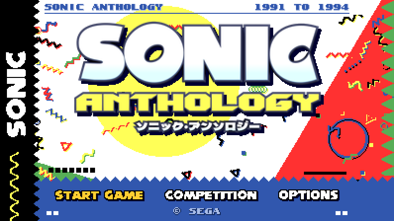</td>
    <td width="50%">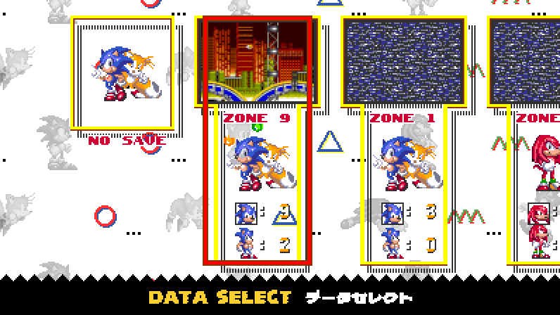</td>
  </tr>
  <tr>
    <td align="center">Title screen</td>
    <td align="center">Data Select, with zone previews</td>
  </tr>
  <tr>
    <td>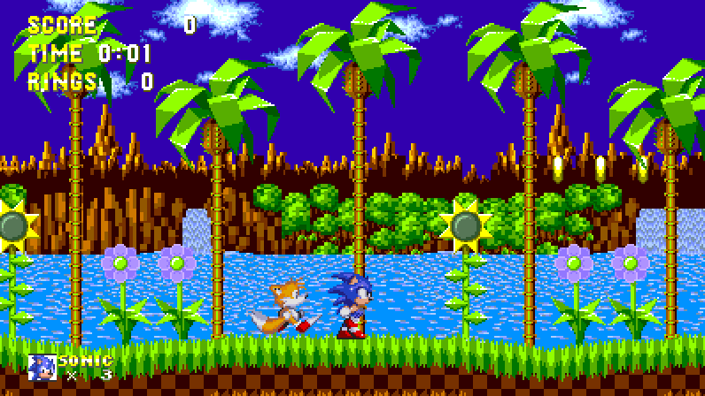</td>
    <td>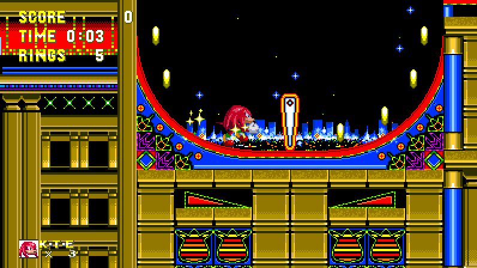</td>
  </tr>
  <tr>
    <td align="center">Sonic 1: Green Hill, Sonic and Tails</td>
    <td align="center">Sonic 2: Casino Night, as Knuckles</td>
  </tr>
  <tr>
    <td>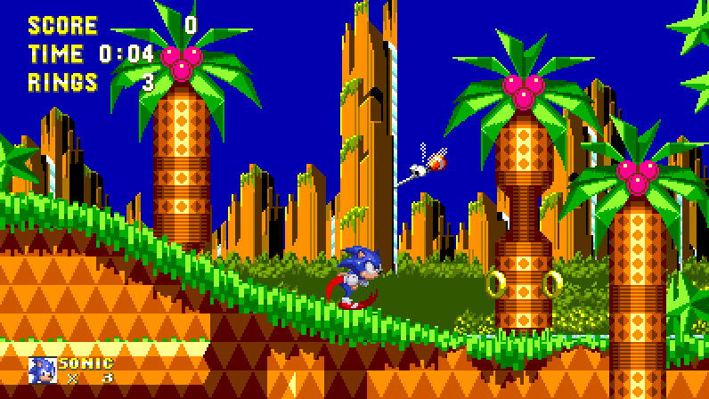</td>
    <td>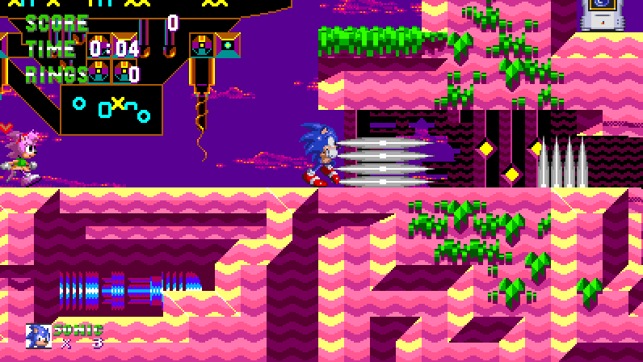</td>
  </tr>
  <tr>
    <td align="center">Sonic CD: Palmtree Panic</td>
    <td align="center">Sonic CD: Collision Chaos, with Amy</td>
  </tr>
  <tr>
    <td>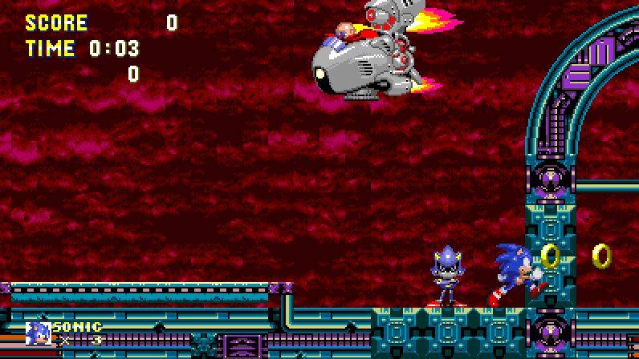</td>
    <td>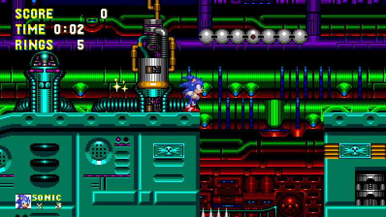</td>
  </tr>
  <tr>
    <td align="center">Sonic CD: the race with Metal Sonic</td>
    <td align="center">Sonic CD: Metallic Madness</td>
  </tr>
  <tr>
    <td>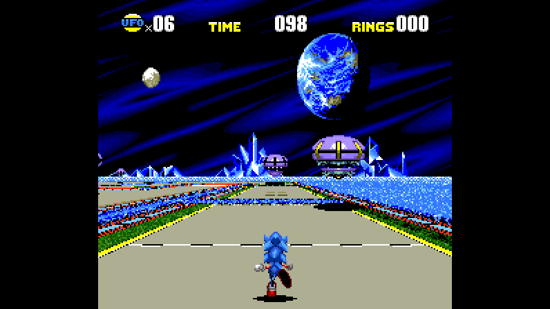</td>
    <td>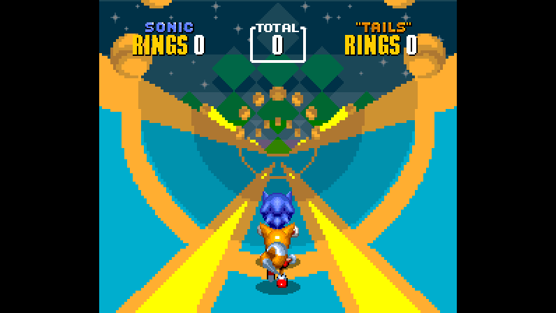</td>
  </tr>
  <tr>
    <td align="center">Sonic CD's UFO special stages</td>
    <td align="center">Sonic 2's half-pipe special stages</td>
  </tr>
</table>

### Smooth rotation

The player tilts to the exact slope, around loops too (Options → Rotation → Smooth).
Classic on the left, smooth on the right, at half speed:

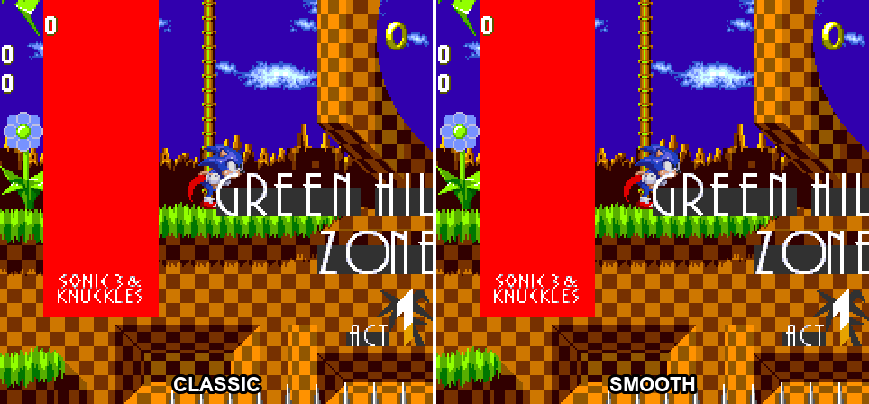

[Watch it as a video (WebM)](docs/media/smooth-rotation.webm)

### Player sprites

Draw the players, monitors and star posts with Sonic Origins' sprites from any of the four
games (Options → Player Sprites):

<table>
  <tr>
    <td>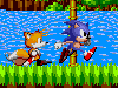</td>
    <td>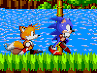</td>
    <td>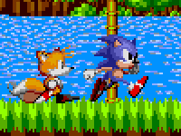</td>
    <td>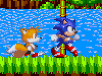</td>
  </tr>
  <tr>
    <td align="center">Sonic 1</td>
    <td align="center">Sonic 2</td>
    <td align="center">Sonic CD</td>
    <td align="center">Sonic 3</td>
  </tr>
</table>

### Tails Assist

Playing as Sonic with Tails, jump, then press Up + jump in the air: Tails takes off
after you and catches you, as in Sonic Mania. While carried, the d-pad steers and jump
flaps; Down + jump lets go. Tails tires after eight seconds.

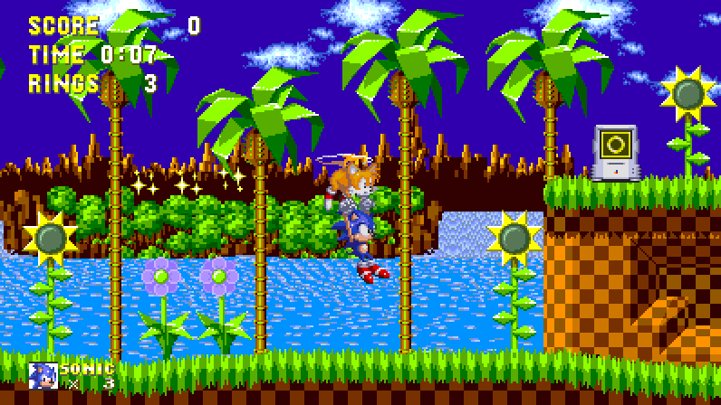

### Background blur

Soften the far background like a camera focused on the action (Options → Background Blur).
Off on the left, high on the right:

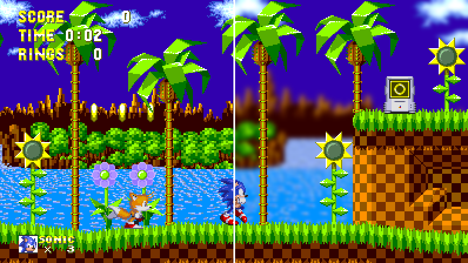

**No ROM or disc data is included.** Sonic Anthology is built on your PC from
your own dumps (and, optionally, your Sonic CD disc) by **AnthologyBuilder**.
The release does carry the Sonic Origins player sprites pack.

How it works: [How Sonic 1 and Sonic 2 got into Sonic 3 & Knuckles](docs/HOW_THE_ZONES_GOT_IN.md).

## Playing

1. Download the latest zip from [Releases](../../releases) and unpack it anywhere.
2. Run **AnthologyBuilder.exe** and choose your dumps (it checks them):

   | Game | Dump | CRC32 |
   |---|---|---|
   | Sonic the Hedgehog | REV01 (World) | `AFE05EEE` |
   | Sonic the Hedgehog 2 | REV01 (World, Rev A) | `24AB4C3A` |
   | Sonic 3 & Knuckles | the 4 MB lock-on cart, **or** Sonic & Knuckles + Sonic 3 | `63522553` (`0658F691` + `9BC192CE`) |
   | Sonic CD *(optional)* | a BIN/CUE dump of the disc (made with the Japanese release); choose its `.cue` | checked by its files |
   | Sonic Origins *(optional: its sprites come with the release)* | its install folder, to repack them from your own copy | its `.rsdk` data packs |

   It writes `sonic3k.bin`, `trilogy.bin` and the Data Select previews beside the
   game (about 7 minutes with the previews); with Sonic CD also `scd.bin` and
   `scdss.bin` (the game plays the music from your disc image, so leave it where
   it is), and with Sonic Origins a fresh `origins.bin` and `origins_ufo.bin`. Dumps left
   beside the game or in a `roms` folder are found automatically. Without Sonic CD
   its zones are simply not offered; add it any time by running the builder again.
3. Press **Play**, or run **SonicAnthology.exe** from then on.

Saves (`sonic3k.srm`), progress (`trilogy-progress.ini`) and settings
(`settings.ini`, including the controls) stay beside the game. F11 or
Alt+Enter toggles fullscreen.

## Building from source

Needs Visual Studio 2022 (MSVC), CMake 3.16+, and Python 3.10+ with Pillow for
the builder. The S3K recompiler reads your Sonic 3 & Knuckles dump at build time.

```bash
git clone --recursive https://github.com/sonsegajp/SonicAnthology.git
cd SonicAnthology
# put your Sonic 3 & Knuckles lock-on dump at game/sonic3k/sonic3k.bin
cmake -S . -B build -G "Visual Studio 17 2022" -A x64
cmake --build build --config Release --target Sonic3KRecomp
python tools/trilogy/builder/trilogy_builder.py build/Release     # the builder, from source
python tools/trilogy/builder/make_builder.py                      # or package AnthologyBuilder.exe (PyInstaller)
```

The trilogy lives in `game/trilogy/` (the C layer) and `tools/trilogy/` (the
converters the builder runs). `tools/trilogy/data/` holds only label addresses,
exported from the Sonic Retro disassemblies by `export_syms.py`.

## Credits & license

Built on [mstan](https://github.com/mstan)'s
[Sonic3AndKnucklesRecomp](https://github.com/mstan/Sonic3AndKnucklesRecomp) and
[segagenesisrecomp](https://github.com/mstan/segagenesisrecomp) (engine changes
on [our fork](https://github.com/sonsegajp/segagenesisrecomp/tree/sonic-trilogy)),
with addresses and names from Sonic Retro's
[skdisasm](https://github.com/sonicretro/skdisasm),
[s1disasm](https://github.com/sonicretro/s1disasm) and
[s2disasm](https://github.com/sonicretro/s2disasm), and Sonic CD's from
[sonic-cd-disassembly](https://github.com/Dobby233Liu/sonic-cd-disassembly)
(Ralakimus and contributors) and
[soniccddecompilation](https://git.sr.ht/~benoitren/soniccddecompilation).
Code: [PolyForm Noncommercial 1.0.0](LICENSE.md); third-party components: see
`segagenesisrecomp/THIRD-PARTY-LICENSES.md`.

Sonic the Hedgehog is a trademark of SEGA. This is a non-commercial fan project,
not affiliated with or endorsed by SEGA. Use your own legally obtained cartridges.

---

## Upstream: Sonic 3 & Knuckles — Recompiled

The rest of this file is the upstream project's README, for the recompiler,
its other build modes and its tooling.


Native x64 static recompilation of **Sonic the Hedgehog 3** and **Sonic &
Knuckles** for the Sega Genesis / Mega Drive, built on the shared
[`segagenesisrecomp`](https://github.com/mstan/segagenesisrecomp) recompiler +
runner.

## Opt-in widescreen experiment

The custom renderer is available in all three targets, developed first on
**Sonic3KRecomp** (the combined cartridge). Open **Mods**, enable **Widescreen**, and select **Adaptive**, **16:9**,
**21:9** or **32:9**. Native rendering remains the default. Adaptive follows
the window beyond 32:9; the same settings are available in the in-game overlay.

The experiment expands stage/background rendering, object activation, rings
and the screen-anchored HUD, with optional gameplay CPU headroom. It does not
rewrite stage collision or decompression. Initial validation covers Angel
Island and Mushroom Hill routes, not every stage or boss. Blue Spheres now has
an expanded ground/sphere projection and edge-anchored counters; its native
board, movement and collection logic are unchanged. Combined-cartridge save
replays cover turning, collection, jumping and the exit fade.
See [renderer notes](game/common/CUSTOM-VIDEO.md) for implementation,
validation and known limits. Existing build caches may need
`-DRECOMP_UI_ENABLE_MODS=ON` to expose the Mods page.

## Knuckles & Knuckles (opt-in gag)

In **Sonic3KRecomp** and **SonicAndKnucklesRecomp**, enable **Mods →
Knuckles & Knuckles** and play as Knuckles. Type **1-74** in **Extra Knuckles**
(default **16**) to choose how many follow you. Busy stages may temporarily
use fewer extras. A controller on player 2-4 drives the matching extra; the rest
use Tails-style CPU following. S3K's title shows a still Knuckles and
**KNUCKLES 3**, and empty save files default to Knuckles. Existing save files
keep their character. Both titles get the "Knuckles & Knuckles" treatment.
Local play only, off by default. See
[docs/KNUCKLES_ARMY.md](docs/KNUCKLES_ARMY.md).

Sonic 3 and Sonic & Knuckles shipped as two separate ~2 MB cartridges; **"Sonic
3 & Knuckles"** is the 4 MB **lock-on** combination of the two (S&K boots at
`$000000`, Sonic 3 maps in at `$200000`). They share one engine, so this repo
hosts all three as **build modes** — each a native target plus a paired
`_oracle` (interpreter parity-reference) target:

| Target | Game / ROM | Ports (native/oracle) | Status |
|---|---|---|---|
| `Sonic3Recomp` | Sonic 3 alone, 2 MB (CRC32 `9BC192CE`) | 4384 / 4385 | **Playable bring-up** (Angel Island, saves) |
| `SonicAndKnucklesRecomp` | Sonic & Knuckles alone, 2 MB (MD5 `4ea493ea…`) | 4388 / 4389 | Bring-up |
| `Sonic3KRecomp` | Sonic 3 & Knuckles combined, 4 MB | 4386 / 4387 | Scaffold / early bring-up |

> **Prebuilt Sonic 3 binaries are on the
> [Releases](https://github.com/mstan/Sonic3AndKnucklesRecomp/releases) page —
> supply your own ROM.** Release binaries are AGPL-free clean-room builds
> (PolyForm Noncommercial 1.0.0 + permissive third-party notices). The AGPL
> clownmdemu core is used only by unshipped development/oracle targets; see
> `segagenesisrecomp/RELEASING.md`.

## Building from source

**Prerequisites**
- A C compiler — Windows: Visual Studio 2022 (MSVC); macOS: Apple Clang (Xcode
  CLT); Linux: Clang/GCC. Plus CMake 3.16+ (and Ninja on macOS/Linux).
- SDL2 2.28+ — bundled on Windows; `brew install sdl2` (macOS); `libsdl2-dev` (Linux).
- Your own legally-obtained ROM(s); ROMs are gitignored and never committed.

**1. Clone.** The shared engine (`segagenesisrecomp`) is a git submodule, so a
recursive clone is self-contained:

```bash
git clone --recursive https://github.com/mstan/Sonic3AndKnucklesRecomp.git
cd Sonic3AndKnucklesRecomp
# (cloned without --recursive? run: git submodule update --init --recursive)
```

`Skipping submodule 'clownmdemu-core'` in that output is expected and correct.
That core is AGPL and dev-only; nothing you build needs it, and CMake skips the
dev-only `_oracle` targets automatically when it is absent.

**2. Supply your own ROM(s).** Either pass the ROM path on the command line, or
drop it into this repo's per-mode game dir so the build copies it next to the exe:

| Mode | Place ROM at | Identity |
|---|---|---|
| Sonic 3 alone | `game/sonic3/sonic3.bin` | CRC32 `9BC192CE` |
| Sonic & Knuckles alone | `game/sandk/sandk.bin` | MD5 `4ea493ea…` (2 MB) |
| S3 & Knuckles | `game/sonic3k/sonic3k.bin` | 4 MB combined |

**3. Build the mode you want, then run.** Generated C is ignored build output;
CMake builds the current recompiler and regenerates the selected mode whenever
its ROM, configuration/discovery inputs, or the recompiler changes.

Windows (MSVC):
```cmd
cmake -S . -B build -G "Visual Studio 17 2022" -A x64
cmake --build build --config Release --target Sonic3Recomp           :: Sonic 3 alone
cmake --build build --config Release --target SonicAndKnucklesRecomp  :: S&K alone
cmake --build build --config Release --target Sonic3KRecomp           :: S3&K combined
build\Release\Sonic3Recomp.exe          :: the build copies the ROM next to the exe
```

macOS / Linux (Ninja + Clang/GCC):
```bash
cmake -S . -B build -G Ninja -DCMAKE_BUILD_TYPE=Release
ninja -C build Sonic3Recomp Sonic3KRecomp
./build/Sonic3Recomp "path/to/Sonic 3.bin"
```

> **Local dev across games:** clone `segagenesisrecomp` once at the workspace root
> and run `scripts/link-engine.sh` (or `.bat`) to share ONE engine checkout; CMake
> prefers the gitignored `engine-local` symlink over the submodule.

Each mode also has an `_oracle` target (e.g. `Sonic3Recomp_oracle`) that runs
the clown68000 interpreter for native↔interpreter parity debugging; it needs
`debug.ini` next to the exe.

### Optional statically recompiled sound Z80

Native targets normally retain the embedded Z80 interpreter. For development,
the sound driver can instead use the flat static backend from
[`smsggrecomp`](https://github.com/mstan/smsggrecomp).
The generated code consumes the framework's pinned
[`z80-recomp-core`](https://github.com/mstan/z80-recomp-core) submodule.
Capture and generate the ROM-derived `<game>_step.c` locally as described in
[`docs/Z80_STATIC_RECOMP.md`](segagenesisrecomp/docs/Z80_STATIC_RECOMP.md), then
configure with:

```bash
cmake -S . -B build-z80 \
  -DGENESIS_Z80_RECOMP=ON \
  -DGENESIS_Z80_AOT_SOURCE=/path/to/generated/s3kz80_step.c
cmake --build build-z80 --config Release --target Sonic3KRecomp
```

The capture and generated C contain ROM-derived data and remain uncommitted.
Opcode shapes are statically decoded; mutable driver operands are read live,
with one-instruction interpreter fallback only for unmatched code. Turbo mode
silences speaker playback while preserving headless WAV capture.

## Layout

This repo owns the Sonic 3 family implementation; only reusable framework
code comes from the pinned `segagenesisrecomp` submodule
(see [docs/REPOSITORY_OWNERSHIP.md](docs/REPOSITORY_OWNERSHIP.md)):

```
Sonic3AndKnucklesRecomp/
├── CMakeLists.txt              ← three build modes
├── game/
│   ├── common/                 ← shared renderer (sonic3_video.c, Blue Spheres)
│   ├── sonic3/ sonic3k/ sandk/ ← game.toml, discovery inputs, <mode>_spec.c, ROM
│   └── skdisasm/               ← pinned source disassembly submodule
├── ghidra/annotations/         ← reproducible annotation exports
├── tests/, tools/, docs/       ← game-owned validation, tooling, documentation
└── segagenesisrecomp/          ← submodule (shared engine)
```

## Manually regenerate the C from a ROM

Use the configured build's generation targets (a normal build also runs them
automatically):

```
cmake --build build --config Release --target genesisrecomp_generate_sonic3
cmake --build build --config Release --target genesisrecomp_generate_sandk
cmake --build build --config Release --target genesisrecomp_generate_sonic3k
```

> Sonic & Knuckles alone shares the S&K master boot path with the combined cart,
> so its disasm data is regenerated from the same byte-perfect `skdisasm`
> `sonic3k.lst` at offset 0 — see `game/sandk/game.toml`.

## Sonic 3 & Knuckles (combined) mode — why it's harder

The combined 4 MB target is early bring-up. Beyond the standalone Sonic 3 work,
it has to handle:

1. **RAM-installed IRQ handlers.** VBlank/HBlank vectors point into 68K RAM
   (`$FFFFFFF0` / `$FFFFFFF6`); boot code copies trampolines into RAM at
   runtime, which a static call-graph walk can't follow without a hook/directive.
2. **Sega lock-on memory map.** S&K at `$000000–$1FFFFF`, Sonic 3 at
   `$200000–$3FFFFF`; S&K code JSRs into the Sonic 3 bank. The runtime must
   honor the lock-on mapping.
3. **Battery SRAM** (`$200001–$203FFF`, odd bytes) for combined save data.
4. **Header quirks**: SSP = `$00000000` (boot sets it), header checksum covers
   only the original 2 MB, and one `NBCD` (`$4300`) opcode appears at `$3000EE`.

See `ISSUES.md` / `FEATURES.md` (currently focused on the Sonic-3-alone mode).

## Audio & video enhancements (opt-in)

The runner includes an optional **verified-enhancement shadow** layer — QoL
audio/video improvements that run alongside the authentic hardware emulation and
substitute only after continuously proving they still match it (reverting loudly
if they ever stop). **Off by default** (output is byte-identical to raw hardware
emulation); enable per-run via environment variables:

| Variable | Values | Effect |
|----------|--------|--------|
| `GENESIS_SCREEN` | `raw` (default), `crt`, `trinitron`, `composite`, `linear` | Present-time color model — maps the Genesis 9-bit gamut through a CRT/phosphor model (gamma + lifted black). `raw` is bit-identical passthrough. |
| `GENESIS_AUDIO_SHADOW` | `0` (default) / `1` | Arms the YM2612 FM shadow — a parallel `ymfm` chip with a relaxed output low-pass that keeps the cleaner, less-aliased highs. |
| `GENESIS_FM_LADDER` | unset (default) / `off` | With `off`, renders the FM shadow through ymfm's ladder-free `ym3438` (no YM2612 DAC crossover crunch). Needs `GENESIS_AUDIO_SHADOW=1`. |

```bash
GENESIS_AUDIO_SHADOW=1 GENESIS_FM_LADDER=off GENESIS_SCREEN=crt ./Sonic3KRecomp sonic3k.bin
```

Full design, verifier algorithm, and rationale: `segagenesisrecomp/docs/SHADOW_ENHANCEMENTS.md`.

## License & ROM

This project's own code: [PolyForm Noncommercial](LICENSE.md) (the recompiler /
build wiring). **Third-party engine components are separately licensed and
mostly AGPL-3.0** — see
`../SonicTheHedgehogRecomp/segagenesisrecomp/THIRD-PARTY-LICENSES.md`.

ROM files are **not** included — supply your own legally-obtained copy.

---

<p align="center">
  <sub><b>R.A.I.D. — Retro AI Development</b> · a Discord for AI-assisted retro reverse-engineering, decomp &amp; recomp</sub>
</p>

<p align="center">
  <a href="https://discord.gg/Ad9BwSzctP"></a>
</p>
